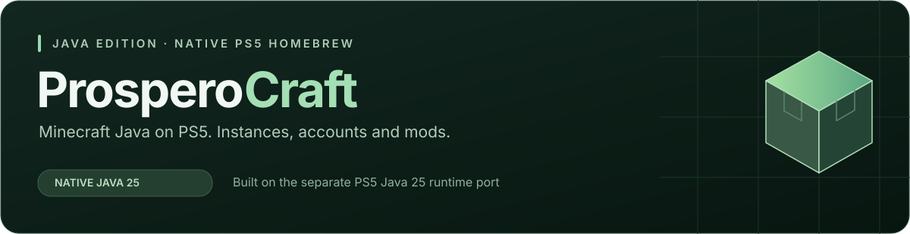
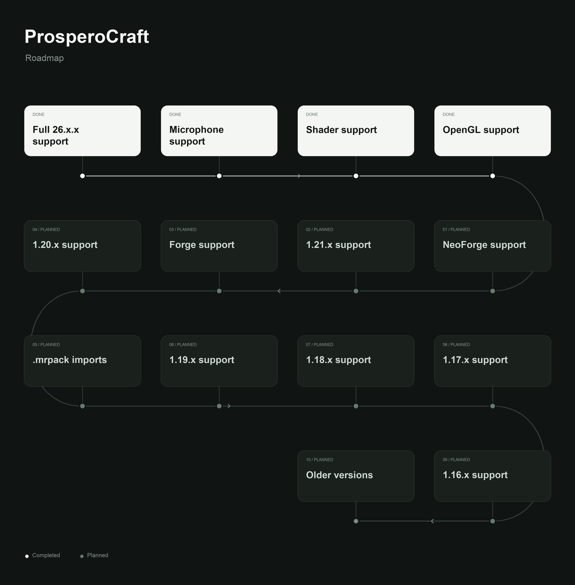

# ProsperoCraft

**Minecraft Java Edition running natively on PlayStation 5, powered by a Native Java 25 Runtime.**

Download Minecraft on your console, keep separate instances for worlds and mods, and play with DualSense controls, native Vulkan graphics and game audio. ProsperoCraft includes Microsoft sign-in, a Modrinth content browser, controller remapping and six saved launcher themes.

**[Download 01.000.256](https://github.com/mateo-cogeanu/ProsperoCraft/releases/tag/01.000.256)** · [Latest release](https://github.com/mateo-cogeanu/ProsperoCraft/releases/latest) · [Changelog](CHANGELOG.md) · [Report an issue](https://github.com/mateo-cogeanu/ProsperoCraft/issues/new/choose)

ProsperoCraft handles Minecraft installation, accounts, input and game integration. Its [Native Java 25 Runtime](https://github.com/mateo-cogeanu/ps5-java25-homebrew) is maintained separately. Official Minecraft game JARs and asset objects are downloaded and verified from the publisher, rather than bundled with the app.

Release **01.000.256** adds Vanilla 1.21.9 support, substantially improved gameplay performance and bug fixes. Fabric 26.1 is marked Experimental. [Release notes](docs/releases/client-vanilla-1219-performance-256.md) · [Console acceptance](docs/validation/client256-console-acceptance-2026-11-06.json).

Release **01.000.212** adds Vanilla1.21.10/1.21.11 and a smoother launcher with a120Hz presentation target, horizontal page turns, adaptive page detents, in-place selectors, live theme previews and a larger icon grid. The physical tester accepts the launcher and explicitly authorizes release of the exact package. [Release notes](docs/releases/client-launcher-vanilla-212.md) · [Console acceptance and limits](docs/validation/client212-console-acceptance-2026-11-04.json). Existing26.x game paths and shader/quit/save repairs remain. Numeric FPS, broad game/mod/shader/device regressions and endurance are unmeasured; all1.21Fabric and earlier1.21 releases remain unavailable. [ProsperoStore update submitted](https://github.com/darkxex/ps5-homebrew-catalog/pull/1121); availability requires catalog approval and deployment.

Experimental [248](docs/validation/client248-shader-cache-handles-2026-11-06.json) limits Mesa cache partitions after a live 26.1.2 chunk failure showed 204 shader-cache handles. Experimental [247](docs/validation/client247-native-medium-pools-2026-11-06.json) extends native buffer pools through 64 KiB after the exact246 Fabric26.2 run again filled the mapping ledger. Experimental [246](docs/validation/client246-native-8k-pool-2026-11-06.json) pools native buffers through 8 KiB after Fabric 26.2 filled the direct mapping ledger in 245. Experimental [245](docs/validation/client245-fabric262-version-check-2026-11-06.json) extends the existing candidate Sodium version-check setting to Fabric 26.2 after its LWJGL mismatch blocked startup. Actual binding compatibility is pending. Experimental [244](docs/validation/client244-native-trace-sampling-2026-11-06.json) samples successful native allocation traces after Fabric stutters coincided with a 412 MB VM trace in 243. Experimental [243](docs/validation/client243-zgc-compiled-locks-2026-11-06.json) removes per-compiled-method native mutex demand after Fabric 26.3 exhausted the reserve in 242. Experimental [242](docs/validation/client242-zgc-native-restore-2026-11-06.json) restores ZGC views with native virtual reservations after 241 reached gameplay/saving but crashed after rejoin. Experimental [241](docs/validation/client241-zgc-device-maps-2026-11-06.json) adds exact direct-device heap mapping after 240 received a moved native mapping. Experimental [240](docs/validation/client240-zgc-reserved-maps-2026-11-06.json) uses checked native mapping hints after ZGC passed reservation and stopped during physical mapping in 239. Experimental [239](docs/validation/client239-zgc-address-window-2026-11-06.json) selects a lower PS5 ZGC heap address window after native reservations at 4 TiB failed in 238. Experimental [238](docs/validation/client238-zgc-reservation-2026-11-06.json) uses native PS5 virtual reservations after ZGC initialization failed in 237. Experimental [237](docs/validation/client237-zgc-2026-11-06.json) integrates generational ZGC with PS5 direct-memory backing. Physical collector initialization and gameplay are pending. Development [235](docs/validation/client235-fabric-native-capacity-2026-11-06.json) expands opt-in native mapping capacity after Fabric 26.3 reached gameplay and stopped during C2 compilation in 233. Diagnostic [233](docs/validation/client233-emfile-capture-2026-11-06.json) preserves the tracked file inventory at the first EMFILE after Fabric 26.3 exhausted descriptors in 232. Development [232](docs/validation/client232-fabric-method-locks-2026-11-06.json) bounds method profiling locks after Fabric 26.3 exhausted the native mutex reserve in 231. Development [231](docs/validation/client231-fabric-condition-reserve-2026-11-06.json) reduces condition-variable usage after Fabric 26.3 exhausted that reserve in 230. Development [230](docs/validation/client230-fabric-mutex-reserve-2026-11-06.json) requests a larger native mutex reserve after a 26.3 Fabric startup crash on PS5. Development [229](docs/validation/client229-tiered-parallel-2026-11-06.json) tests tiered C2 compilation and Parallel GC with live safepoint diagnostics. Diagnostic [228](docs/validation/client228-save-descriptors-2026-11-06.json) restores live handle tracking after 1.21.9 hit descriptor exhaustion during saves. Development [227](docs/validation/client227-vanilla1219-2026-11-06.json) enables Vanilla 1.21.9 as DEV TEST and gives Vanilla 1.21.10 and 1.21.11 normal launcher labels. [226](docs/validation/client226-download0-default-2026-11-06.json) restores download0 defaults and pauses automatic migration. [225](docs/validation/client225-vanilla-startup-trace-2026-11-06.json) tests whether synchronous audio tracing contributes to the 26.3 Vanilla slowdown. Diagnostic [224](docs/validation/client224-loading-freeze-diagnostics-2026-11-05.json) samples startup threads for the reported 26.3 freezes. Development [223](docs/validation/client223-shared-jit-startup-2026-11-05.json) fixes the shared-storage launch gate. [222](docs/validation/client222-incremental-storage-2026-11-05.json) replaces the startup bulk move with verified background instance and cache transfers. [220](docs/validation/client220-one-time-move-2026-11-05.json) explains that the library only needs to move once. [219](docs/validation/client219-library-progress-2026-11-05.json) adds a library migration progress bar with separate copy and verification percentages. [218](docs/validation/client218-library-startup-2026-11-05.json) shows library migration progress and lets Circle pause the move and open the verified original library for that session. [217](docs/validation/client262-crash-report-2026-11-05.json) restores the TinyFD binding used during 26.2 startup. Development carries forward the [216](docs/client-primary-shared-storage-216.md) changes for primary shared content/reports/tmp with verified copy-before-switch and readable legacy fallback, clean card labels and correct instance-settings Back navigation. Physical console validation is pending; released212 remains unchanged.

## What can I play?

Earlier release **01.000.167** added supported Minecraft26.2 Fabric, controller/keyboard/mouse handoff fixes, launcher mouse and keyboard controls, and a rounded vector cursor that follows the saved theme. The user accepts this exact build and explicitly requests release. [Release notes](docs/releases/client-input-fabric-167.md) · [Console acceptance](docs/validation/client167-console-acceptance-2026-10-30.json). Broader device coverage and long-session endurance remain unmeasured.

| Minecraft version | Vanilla | Fabric |
| --- | --- | --- |
| **26.1 / 26.1.1 / 26.1.2** | Supported with normal Play/Ready states in 204. | Supported; matching loader, mods and shader versions required. |
| **26.3** | Established playable PS5 baseline, including game audio and server joining. | Released, with positive console feedback. Mods still need individual compatibility checks. |
| **26.2** | Released with earlier positive play/keyboard feedback. New launch crash reported. Console retest pending. | [Missing TinyFD binding confirmed on 212](docs/validation/client262-crash-report-2026-11-05.json). Candidate 217 restores it. Console retest pending. |
| **26.4 snapshots 1–6** | Available; positive console feedback on 118/119. Use separate test worlds. | Selectable when matching loader/mod versions exist; snapshot-specific Fabric, Controlify and mod compatibility is not established. |
| **1.21.9 / 1.21.10 / 1.21.11** | Available in 256. Earlier releases remain Coming soon. | Coming soon for all1.21 releases. |
| **Other versions** | Unsupported 26.x catalog entries may download, but Play stays blocked. 1.21.x requires the separate development candidate described above. | No additional compatibility claim. NeoForge is not enabled. |

The user accepted166’s Controlify controller detection and physical input handoff repair, then accepted167’s launcher keyboard/mouse and cursor work.167 removes the Fabric26.2 development labels. Mod compatibility still depends on the exact game/mod versions; no universal compatibility or endurance claim is made. [Launcher input details](docs/client-launcher-desktop-167.md).

Snapshots are **hidden by default**. Enable **Settings → Show Snapshots** to list them; explicit saved preferences are retained. Future snapshots are not enabled automatically. See the [snapshot guide](docs/client-snapshots-118.md) and [119 console acceptance](docs/validation/client119-console-acceptance-2026-10-28.json).

Compatible displays can use output up to 120 Hz, with a 60 Hz fallback. A tester reported 119 FPS on build 097; release 100 received positive smoothness feedback. This is not a constant 120 FPS guarantee or fully uncapped presentation. [High-refresh details](docs/client-high-refresh-097.md).

Separate [Fabric and Paper server downloads](https://github.com/mateo-cogeanu/ProsperoCraft/releases/tag/Fabric-Paper-v01.000.108) have positive console playtests and their own [setup guide](docs/releases/fabric-paper-108.md). Server and client version counters are independent; server lifecycle and two-hour endurance checks remain incomplete.

## Install or update

You need a PS5 with a working homebrew app installation/launch workflow, an internet connection for initial downloads and sign-in, and a Microsoft account that owns Minecraft Java Edition with a Java profile for full-game play.

1. Back up important worlds before updating. Preserve **`/download0/ProsperoCraft`**, which holds instances, downloads, settings and saved account data.
2. Open the [latest release](https://github.com/mateo-cogeanu/ProsperoCraft/releases/latest) and download **`PPSA99874.zip`** from Assets. `SHA256SUMS` is available beside it for verification.
3. Extract the complete **`PPSA99874`** folder and install or replace the app through your existing homebrew workflow. Keep all files together. Launch ProsperoCraft from your homebrew launcher.
4. Follow the first-launch steps below. Existing instances and cached downloads are retained when their data directory is preserved.

The app requests 4 GiB of storage. **Client and server share title ID PPSA99874: installing one replaces the other.** Keep the server package separately if you want to reinstall it. ProsperoStore availability can lag GitHub releases. [Release notes and validation limits](docs/releases/client-native-compatibility-153.md).

### First launch

1. Open **Account / Sign in**. Scan the QR code or open the Microsoft link shown on screen on another device, then enter the displayed code and approve sign-in.
2. Return to ProsperoCraft. Full-game launch checks your Minecraft Java entitlement and profile. Successful sign-in opens **Instances**.
3. Select the **+** card. Choose a version, **Vanilla** or **Fabric**, a name and an icon. For a first playtest, use Vanilla 26.3.
4. Select the instance, choose **Download & Play**, and let the launcher download and verify its game files. Read the PLAY controls guide, confirm it, and create a new world or join a compatible server.

Updating from a build before 120 requires **one fresh sign-in**: release 120 switched to ProsperoCraft's approved Microsoft application. Later launches can restore saved sign-in; sign out clears saved credentials. Live sign-in and restoration with the new application still need broader PS5 validation. See [account migration and troubleshooting](docs/client-auth-approved-2026-10-29.md).

Instance Settings offers rename, icon selection, duplication and deletion. **Deleting an instance permanently deletes its worlds, mods and settings after confirmation; there is no Undo.** Duplicate Instance makes an independent copy for experiments. Settings also offers color themes, animated backgrounds, Reduced Motion and a resolution dropdown; actual display modes depend on the connected screen.

## Controls

Use the controller in the native launcher: **L1/R1** changes tabs, **D-pad or left stick** moves focus, **X** selects and **Circle** goes back. **OPTIONS** opens the full controls guide; a shorter guide appears before Play.

| Default fallback controls | Action |
| --- | --- |
| Left stick / right stick | Move / look |
| X / Circle / L3 | Jump / sneak / sprint |
| R2 / L2 | Mine or attack / use or place |
| Triangle / L1 / R1 | Inventory / previous hotbar slot / next hotbar slot |
| Right stick in game menus | Move the pointer; X or R2 clicks, L2 right-clicks |
| L3 in game menus | Open the on-screen text keyboard after selecting a text field |

These mappings use Minecraft's default keybinds. Change fallback gameplay bindings in **Settings → Input & Controller Keybinds**. The in-app OPTIONS guide is the current full reference; [the input guide](docs/client-fabric-input-105.md) explains remapping and hardware limits.

**Controlify** and required dependencies are installed once during setup of new Fabric instances. Existing instances and later uninstalls are respected. The fallback adapter hands over when a mod opens a controller. SDL3 integration and controller/haptic feedback are implemented, but adaptive-trigger feel, reconnect behavior and each game/mod version still need testing. [Controlify defaults](docs/client-default-controlify-unicode-115.md) · [Trigger limitations](docs/client-buttons-triggers-117.md).

Physical **keyboard and mouse input is implemented for gameplay**, with positive PS5 keyboard feedback. The native launcher remains controller-operated. Text input uses US ASCII; international layouts/IME, Bluetooth combinations and broader mouse/reconnect behavior are not fully validated.

## Mods, shaders and resource packs

The user confirms shader rendering and Quit Game pass on local build202. Build203uses normal PLAY/READY/SUPPORTED labels for26.1,26.1.1and26.1.2 Vanilla/Fabric. Ordinary gameplay was previously reported working across all six combinations; a complete shader/quit version matrix, performance and endurance remain separately scoped. 26.3 save failures now reproduce EMFILE;204tests reduced archive descriptor use and fuller handle diagnostics, with physical save/reload and regression pending. These local builds are not a new released/Store version. [Status and exact test scope](docs/client-zink-ready-203.md).

Open **Instance Settings → Mods, Shaders or Resource Packs** to browse Modrinth, search, select downloads and use **Download All**. The launcher verifies downloads, resolves required dependencies and can upgrade managed dependencies when required. **Installed** lists show what is present and offer per-file **Uninstall** with confirmation. Install only content matching the instance's game version and loader. [Content guide](docs/client-fabric-modrinth-103.md) · [Dependency handling](docs/client-dependency-updates-111.md).

- **Shaders:** released Vulkan builds use Vitrail and reject OpenGL-only Iris. Local Zink/OpenGL development197 permits Iris testing; shader compatibility remains unvalidated. Pack compatibility and performance vary; no general shader-FPS target is validated. [Iris explanation](docs/client-iris-vulkan-110.md) · [Performance findings](docs/client-performance-investigation-117.md).
- **Distant Horizons:** a PS5 integration exists, but rendering and persistence compatibility remain work in progress. It is not a generally supported mod. [Integration and limits](docs/client-native-input-storage-112.md).
- **Resource packs:** browsing, verified downloads, safe Unicode filenames and uninstall are implemented. A successful download does not prove a pack renders correctly on every supported version.

NeoForge and `.mrpack` imports are not available. Fabric support does not imply that every desktop mod, native dependency or shader pack works on PS5.

NeoForge [Phase A research](docs/client-neoforge-plan.md) now records upstream builds and integration requirements. Implementation decisions and all NeoForge console validation remain pending.

## Known limitations and troubleshooting

- **LAN hosting is deferred.** Joining servers has earlier PS5 confirmation; Open to LAN is not established working.
- **Save/reload improved after the file-handle repair**, with positive world play/reload feedback on 114. Broader world lifecycle, long sessions and exact 153 regressions still need testing. Back up important saves. [World-access repair](docs/client-world-handles-114.md).
- **Performance and device coverage remain under testing:** shader frame times, audio across reloads, resolution/input alignment, account recovery, reconnect and repeated quit/relaunch are not exhaustively validated.
- **Microphone capture is not implemented.** Adaptive-trigger approximations are not identical to full native per-zone profiles.

If Play says Coming soon, compare the **version and loader** with the compatibility table above. For an Iris warning on a Vulkan build, uninstall Iris through Installed before retrying. For account problems after an older update, use a fresh sign-in. Report persistent problems through the [bug, mod or shader issue forms](https://github.com/mateo-cogeanu/ProsperoCraft/issues/new/choose), including app/game/loader/content versions and steps to reproduce. Working mods and shaders are useful reports too. Keep account tokens and private logs out of public reports.

## Roadmap

### Completed milestones

The table links each capability to its first public release. Initial development builds are noted where useful; three-digit build numbers abbreviate 01.000.xxx. Console limitations above still apply. See the [changelog](CHANGELOG.md) for the full milestone archive.

| Feature | First available version | What it enables |
| --- | --- | --- |
| Minecraft menu, then playable worlds | [Menu 062](https://github.com/mateo-cogeanu/ProsperoCraft/releases/tag/Client_Menu-v01.000.062); [world 065](https://github.com/mateo-cogeanu/ProsperoCraft/releases/tag/Client_World-v01.000.065); [playable 066](https://github.com/mateo-cogeanu/ProsperoCraft/releases/tag/Client_Playable-v01.000.066) | The first menu, world entry and responsive gameplay checkpoints; 066 did not yet have audible sound. |
| Native instance launcher and resolution selection | [Development 079](docs/client-instances-079.md) → [01.000.082](https://github.com/mateo-cogeanu/ProsperoCraft/releases/tag/01.000.082) | Separate instances, resolution choices and quit/relaunch. Audio was confirmed on development 067 before this release. |
| Vulkan launcher and authenticated play | [Development 087](docs/client-toolkit-087.md) / [090](docs/client-temp-gametest-090.md) → [01.000.096](https://github.com/mateo-cogeanu/ProsperoCraft/releases/tag/01.000.096) | Animated Vulkan UI and owned-account play; saved sign-in began in 091, permanent deletion in 094, both first public in 096. |
| CPU reporting and launcher vibration | [Development 086](docs/client-shared-fixes-086.md) / [089](docs/client-vibration-089.md) → [01.000.096](https://github.com/mateo-cogeanu/ProsperoCraft/releases/tag/01.000.096) | Actual CPU identity/count, centered tab labels and optional launcher vibration. Expanded resolution dropdowns followed in development 091, also first public in 096. |
| High-refresh output | [Development 097](docs/client-high-refresh-097.md) → [01.000.100](https://github.com/mateo-cogeanu/ProsperoCraft/releases/tag/01.000.100) | Up to 120 Hz on compatible displays; 098 remains a draft, and 100 delivers the accepted smoother policy. |
| Custom player skins and clearer game-menu controls | [01.000.101](https://github.com/mateo-cogeanu/ProsperoCraft/releases/tag/01.000.101) | Owned skins, cursor-only menu selection and clearer account/navigation controls. |
| Fabric and Modrinth content | [Development 103](docs/client-fabric-modrinth-103.md) → [01.000.108](https://github.com/mateo-cogeanu/ProsperoCraft/releases/tag/01.000.108) | Content browsing and dependency repair; installed lists began in 106, uninstall in 107, both first public in 108. |
| Remapping, physical input and Controlify integration | [Development 105](docs/client-fabric-input-105.md) / [106](docs/client-input-audio-installed-106.md) → [01.000.108](https://github.com/mateo-cogeanu/ProsperoCraft/releases/tag/01.000.108) | Saved fallback bindings and keyboard/mouse gameplay; SDL3 integration for Controlify, with hardware/version limits above. |
| World-access repair, default Controlify and instance copies | [Development 114](docs/client-world-handles-114.md) / [115](docs/client-default-controlify-unicode-115.md) / [116](docs/client-duplicate-triggers-116.md) → [01.000.117](https://github.com/mateo-cogeanu/ProsperoCraft/releases/tag/01.000.117) | Improved save/reload, one-time controller-mod setup and independent Duplicate Instance copies. |
| Six supported 26.4 snapshots | [Development 118](docs/client-snapshots-118.md) → [01.000.119](https://github.com/mateo-cogeanu/ProsperoCraft/releases/tag/01.000.119) | Snapshots 1–5 worked on 118; 119 repaired snapshot 6. Visibility stays off by default. |
| Approved ProsperoCraft sign-in | [01.000.120](https://github.com/mateo-cogeanu/ProsperoCraft/releases/tag/01.000.120) | Own approved Microsoft application and app-bound saved credentials; requires fresh sign-in from older builds. |
| Six color themes | [01.000.121](https://github.com/mateo-cogeanu/ProsperoCraft/releases/tag/01.000.121) | Six saved palettes and a smoother fallback pointer; broader PS5 persistence/input checks remain pending. |
| Fabric26.2 and launcher input | [01.000.167](https://github.com/mateo-cogeanu/ProsperoCraft/releases/tag/01.000.167) | User accepted exact167; supported Fabric26.2, Controlify handoff and launcher keyboard/mouse. |
| Vanilla 26.2 | [Development 124](docs/client-26.2-vulkan-handoff-124.md) → [01.000.153](https://github.com/mateo-cogeanu/ProsperoCraft/releases/tag/01.000.153) | Vanilla 26.2 play; Fabric 26.2 remains held. |

## Credits and license

- **GUI:** [Mihawk's PS5_VKHomebrewUI](https://github.com/mihawk-99/PS5_VKHomebrewUI), based on [BlackBearReloaded's ps5-homebrew-ui](https://github.com/blackbearreloaded/ps5-homebrew-ui).
- **Instance artwork:** [MultiMC](https://github.com/MultiMC/Launcher) and [Prism Launcher](https://github.com/PrismLauncher/PrismLauncher) contributors. Original authors and artwork licenses are retained in the [icon attribution](assets/launcher-icons/attribution.json). [Project artwork and provenance](assets/branding/README.md).
- **Runtime and native components:** [PS5 Java 25](https://github.com/mateo-cogeanu/ps5-java25-homebrew), OpenJDK, Mesa/RADV, SDL, LWJGL, OpenAL Soft and other upstream contributors. Mod and pack thumbnails belong to their authors; image decoding uses libwebp and STB.

Original ProsperoCraft code is **GPL-3.0-or-later**, copyright © 2026 mateo-cogeanu, ProsperoCraft. See [LICENSE](LICENSE) and [NOTICE](NOTICE) for redistribution, source and upstream notices. Upstream components and artwork retain their own terms. Releases include matching OpenAL corresponding source/relink materials and checksums.

Minecraft files and third-party trademarks are not relicensed by this project. ProsperoCraft is unofficial and is not affiliated with Mojang, Microsoft or Sony.

Frozen source snapshots now live in the [source history archive](https://github.com/mateo-cogeanu/ps5-homebrew-history). Active builds stay here; original release downloads and tags are unchanged. See [source organization and build verification](docs/source-organization.md).

## Contributor host checks

Run `python3 tools/run_host_tests.py --fetch-deps` with Python 3.10+ and JDK 25.
See [portable host testing](docs/host-testing.md) for the offline fast lane, optional
native checks, discovery overrides, CI boundaries and tooling inventory.

Contributor tooling: [shared bootstrap, package audits and current identity](docs/tooling-sharing.md).

Local development: [168 shared-tooling regression candidate](docs/client-shared-tooling-test-168.md) passes host/SDK/package/relink checks; exact PS5 validation remains pending. This is not a public binary release.

## Contributing and security

See [contribution and sanitized bug-reporting guidance](CONTRIBUTING.md),
[private vulnerability reporting](SECURITY.md) and the [documentation index](docs/README.md).
Historical launcher previews and maintainer work orders are preserved in the
[indexed documentation archive](docs/documentation-history.md).
