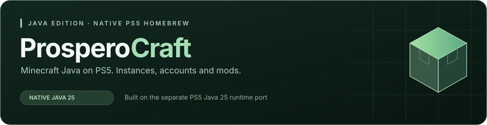
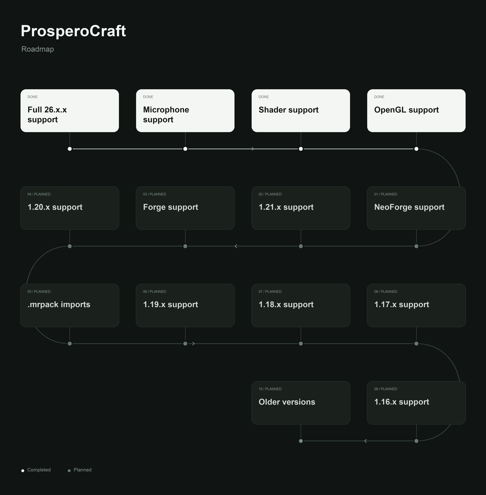

# ProsperoCraft

**Minecraft Java Edition running natively on PlayStation 5, powered by a Native Java 25 Runtime.**

Download Minecraft on your console, keep separate instances for worlds and mods, and play with DualSense controls, native Vulkan graphics, game audio and voice chat. ProsperoCraft includes Microsoft sign-in and offline profiles, a Modrinth content browser, controller remapping, six launcher themes and early beta LAN server hosting.

**[Download the latest release](https://github.com/mateo-cogeanu/ProsperoCraft/releases/latest)** · [Changelog](CHANGELOG.md) · [Report an issue](https://github.com/mateo-cogeanu/ProsperoCraft/issues/new/choose)

ProsperoCraft handles Minecraft installation, accounts, input and game integration. Its [Native Java 25 Runtime](https://github.com/mateo-cogeanu/ps5-java25-homebrew) is maintained separately. Official Minecraft game JARs and asset objects are downloaded and verified from the publisher, not bundled with the app.

## What can I play?

| Minecraft version | Vanilla | Fabric |
| --- | --- | --- |
| **26.3** | Supported, including game audio and server joining. | Supported. Mods need individual compatibility checks. |
| **26.2** | Supported. A newer launch crash was reported and needs a console retest. | Supported. A [missing TinyFD binding](docs/validation/client262-crash-report-2026-11-05.json) was repaired; console retest pending. |
| **26.1 / 26.1.1 / 26.1.2** | Supported. | Supported with matching loader, mod and shader versions. |
| **26.4 snapshots 1–6** | Available behind **Settings → Show Snapshots**. Use separate test worlds. | Selectable when matching loader and mod versions exist; not validated. |
| **1.21 through 1.21.11** | Supported. | Supported. |
| **Other versions** | May download, but Play stays blocked. | NeoForge is not available yet. |

Compatible displays can run at up to 120 Hz, with a 60 Hz fallback. This is not a constant 120 FPS guarantee. [High-refresh details](docs/client-high-refresh-097.md).

## Install or update

You need a PS5 with a working homebrew install and launch workflow, an internet connection for downloads and sign-in, and either a Microsoft account that owns Minecraft Java Edition or a local offline profile.

1. **Back up your worlds first.** Preserve **`/download0/ProsperoCraft`**, which holds instances, downloads, settings and saved account data.
2. Download **`PPSA99874.zip`** from the [latest release](https://github.com/mateo-cogeanu/ProsperoCraft/releases/latest). `SHA256SUMS` sits beside it for verification.
3. Extract the complete **`PPSA99874`** folder and install or replace the app through your homebrew workflow, keeping all files together.
4. Launch ProsperoCraft. Existing instances and downloads are kept when the data folder is preserved.

The app requests 4 GiB of storage. **The separate server package shares title ID PPSA99874, so installing one replaces the other.** ProsperoStore availability can lag behind GitHub releases.

### First launch

1. Open **Accounts**. Sign in with Microsoft by scanning the QR code or opening the link on another device and entering the code, or create a **local offline profile** with just a username.
2. On **Instances**, select the **+** card and choose a version, **Vanilla** or **Fabric**, a name and an icon. Vanilla 26.3 is a good first test.
3. Select the instance and choose **Download & Play**. The launcher downloads and verifies the game files, shows a short controls guide, then starts Minecraft.

Offline profiles cover singleplayer and servers set to offline mode. [Profile guide](docs/client-local-profiles-287.md). Updating from a build older than 120 needs one fresh Microsoft sign-in. [Account troubleshooting](docs/client-auth-approved-2026-10-29.md).

**Instance Settings** offers rename, icon, duplicate, repair and delete. **Deleting an instance permanently removes its worlds, mods and settings.** You hold X to confirm, and there is no undo.

## Controls

In the launcher: **L1/R1** switch tabs, **L2/R2** turn pages, the **D-pad or left stick** moves, **X** selects and **Circle** goes back. **OPTIONS** opens the full controls guide. A mouse and keyboard also work.

| Default in-game controls | Action |
| --- | --- |
| Left stick / right stick | Move / look |
| X / Circle / L3 | Jump / sneak / sprint |
| R2 / L2 | Mine or attack / use or place |
| Triangle / L1 / R1 | Inventory / previous hotbar slot / next hotbar slot |
| Right stick in menus | Move the pointer; X or R2 clicks, L2 right-clicks |
| L3 in menus | Open the on-screen keyboard after selecting a text field |

Change these in **Settings → Input & Controller Keybinds**. [Input guide](docs/client-fabric-input-105.md).

New Fabric instances install **Controlify** once during setup; ProsperoCraft hands the controller over when a mod takes it. Physical keyboard and mouse work in game with a US layout. The controller microphone works with Simple Voice Chat; use the controller's mute button or PS5 system mute.

## Mods, shaders and resource packs

Open **Instance Settings → Mods, Shaders or Resource Packs** to browse Modrinth, search, and use **Download All**. The launcher verifies downloads and resolves required dependencies. **Installed** lists let you enable, disable or uninstall each file. [Content guide](docs/client-fabric-modrinth-103.md).

You can also upload files from a phone or computer: open **Instance Settings → Browser uploads**, then scan the QR code or open the address and enter the pairing code. Drag and drop works, with progress for each file.

- **Shaders:** Vulkan instances use Vitrail; OpenGL-only Iris is refused. Shader rendering is confirmed on PS5, but pack compatibility and performance vary. [Why Iris needs OpenGL](docs/client-iris-vulkan-110.md).
- **Resource packs:** downloads are verified, but a successful download doesn't prove a pack renders correctly on every version.
- **Not available:** NeoForge and `.mrpack` imports. Fabric support doesn't mean every desktop mod works on PS5.

## Server hosting (early beta)

Turn on **Settings → Server [BETA]** to show the **Servers** tab. Choose a Vanilla 26.x version, accept the Minecraft EULA and start the server. ProsperoCraft restarts into server mode and shows the address to join from Minecraft Java on the same network.

You can control the server from a phone or computer. Scan the QR code on the Servers tab, or open the address shown, and enter the pairing code. From there you can start and stop the server, follow the console and send basic admin commands, see players and uptime, and change common server settings while it's stopped.

Each version keeps its own world. Instances are available again after you stop hosting. Separate [Fabric and Paper server downloads](docs/releases/fabric-paper-108.md) also exist.

## Known limitations

- **Back up important worlds.** Save and reload work, but long sessions and every world lifecycle aren't exhaustively tested.
- **Open to LAN** from inside a game is not established; use server hosting instead.
- **Performance varies** with shaders and mods. Reconnects, repeated quit and relaunch, and long play sessions are still being tested.
- **Adaptive triggers** approximate, rather than match, full native per-zone profiles.

If Play says **Coming soon**, check the version and loader against the table above. If you see an Iris warning, uninstall Iris from Installed. Report problems through the [issue forms](https://github.com/mateo-cogeanu/ProsperoCraft/issues/new/choose) with your app, game, loader and mod versions. Working mods and shaders are useful reports too. Keep account tokens and private logs out of public reports.

## Roadmap

- **Third-party accounts:** Ely.by first, alongside Microsoft, for compatible community servers and skins. [Ely.by documentation](https://docs.ely.by/en/minecraft-auth.html)
- **Minecraft 1.20.x:** Vanilla 1.20 through 1.20.6. [Compatibility plan](docs/client-1.20-plan.md)
- **Forge and NeoForge.** [NeoForge research](docs/client-neoforge-plan.md)

See the [changelog](CHANGELOG.md) for every release and its validation.

## Credits and license

- **GUI:** [Mihawk's PS5_VKHomebrewUI](https://github.com/mihawk-99/PS5_VKHomebrewUI), based on [BlackBearReloaded's ps5-homebrew-ui](https://github.com/blackbearreloaded/ps5-homebrew-ui).
- **Instance artwork:** [MultiMC](https://github.com/MultiMC/Launcher) and [Prism Launcher](https://github.com/PrismLauncher/PrismLauncher) contributors. Original authors and licenses are kept in the [icon attribution](assets/launcher-icons/attribution.json). [Project artwork and provenance](assets/branding/README.md).
- **Runtime and native components:** [PS5 Java 25](https://github.com/mateo-cogeanu/ps5-java25-homebrew), OpenJDK, Mesa/RADV, SDL, LWJGL, OpenAL Soft and other upstream contributors. Mod and pack thumbnails belong to their authors; image decoding uses libwebp and STB.

Original ProsperoCraft code is **GPL-3.0-or-later**, copyright © 2026 mateo-cogeanu, ProsperoCraft. See [LICENSE](LICENSE) and [NOTICE](NOTICE) for redistribution, source and upstream notices. Upstream components and artwork keep their own terms. Releases include matching OpenAL corresponding source, relink materials and checksums.

Minecraft files and third-party trademarks are not relicensed by this project. ProsperoCraft is unofficial and is not affiliated with Mojang, Microsoft or Sony.

## Contributing

Run `python3 tools/run_host_tests.py --fetch-deps` with Python 3.10+ and JDK 25. See [portable host testing](docs/host-testing.md), [shared tooling](docs/tooling-sharing.md) and [source organization](docs/source-organization.md). Frozen source snapshots live in the [source history archive](https://github.com/mateo-cogeanu/ps5-homebrew-history).

See [contribution and sanitized bug-reporting guidance](CONTRIBUTING.md), [private vulnerability reporting](SECURITY.md), the [documentation index](docs/README.md) and the [documentation archive](docs/documentation-history.md).
