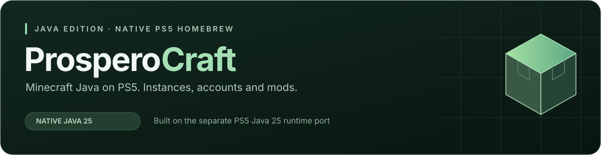

# ProsperoCraft

**Minecraft Java Edition running natively on PlayStation 5, powered by a Native Java 25 Runtime.**

Download Minecraft on your console, manage separate instances and play with DualSense controls, native graphics and game audio. Minecraft gameplay and account login have been tested on PS5. The high-refresh update reached 119 FPS in console testing; extended endurance remains under testing.

**[Download 01.000.121](https://github.com/mateo-cogeanu/ProsperoCraft/releases/tag/01.000.121)** · [Install and release notes](docs/releases/client-themes-cursor-121.md) · [Changelog](CHANGELOG.md)

## Downloads

| Release | Includes |
| :--- | :--- |
| [**ProsperoCraft 01.000.121**](https://github.com/mateo-cogeanu/ProsperoCraft/releases/tag/01.000.121) | Six saved color themes, uniform Settings bars and a smooth vector-based fallback cursor. |
| [**ProsperoCraft 01.000.120**](https://github.com/mateo-cogeanu/ProsperoCraft/releases/tag/01.000.120) | Approved ProsperoCraft Microsoft application and app-bound saved logins. A fresh sign-in is required after updating. |
| [**ProsperoCraft 01.000.119**](https://github.com/mateo-cogeanu/ProsperoCraft/releases/tag/01.000.119) | 26.4 snapshots 1–6, snapshot 6 native startup repair, and snapshots hidden by default. |
| [**ProsperoCraft 01.000.117**](https://github.com/mateo-cogeanu/ProsperoCraft/releases/tag/01.000.117) | Instance duplication, consistent animated controls, default Controlify, world-handle repair and improved dependency queues. |
| [**ProsperoCraft 01.000.108**](https://github.com/mateo-cogeanu/ProsperoCraft/releases/tag/01.000.108) | Fabric, Modrinth content, dependency repair, input controls, larger icons and Uninstall. |
| [**ProsperoCraft 01.000.101**](https://github.com/mateo-cogeanu/ProsperoCraft/releases/tag/01.000.101) | Clearer tabs, correct account actions, dropdown resolution, cursor-only game menus and custom player skins. |
| [Previous high-refresh release 01.000.100](https://github.com/mateo-cogeanu/ProsperoCraft/releases/tag/01.000.100) | Smoother gameplay, up to 120 Hz output, 60 Hz fallback and the correct in-app version. |
| [Previous authenticated launcher 01.000.096](https://github.com/mateo-cogeanu/ProsperoCraft/releases/tag/01.000.096) | Authenticated-play experiment, Vulkan launcher, instance downloads, saved sign-in, controller keyboard and refreshed presentation. |
| [Previous launcher 01.000.083](https://github.com/mateo-cogeanu/ProsperoCraft/releases/tag/01.000.083) | Preserved Demo release and fixed 1080p baseline. |
| [Fabric / Paper servers 01.000.108](https://github.com/mateo-cogeanu/ProsperoCraft/releases/tag/Fabric-Paper-v01.000.108) | Separate server builds with positive console playtests; extended lifecycle/endurance checks pending. |

Install the release's **PPSA99874.zip** using your normal homebrew workflow. The launcher downloads and verifies original publisher files on the console; official Minecraft game JARs and asset objects are not bundled. A valid Java Edition entitlement/profile is required for authenticated full-game play.

The client and server share **PPSA99874**: installing one replaces the other. Back up your worlds and preserve `/download0/ProsperoCraft` when updating. Storage remains 4 GiB; existing instances and cache are retained. Instance deletion is permanent after confirmation, including that instance's worlds—there is no Undo for new deletions.

Release 120 switches from Mojang's application client ID to ProsperoCraft's own approved Microsoft application. **Everyone must sign in again once after updating.** Instances, worlds, downloads and settings are preserved; snapshots stay off by default. The user confirmed release 120 is available on ProsperoStore after [PR923](https://github.com/darkxex/ps5-homebrew-catalog/pull/923).

## Current status

- **26.3 is the accepted playable baseline.** The user confirms all six supported 26.4 snapshots work after the snapshot 6 native JNA repair. Their experimental labels are removed in source for the next build. Snapshots remain off by default. Other versions remain download-only; see [snapshot test notes](docs/client-snapshots-118.md).
- **Login and gameplay are console-tested in published builds.** Build 120 uses the approved ProsperoCraft application and requires a fresh sign-in instead of reusing legacy refresh credentials; [migration and validation](docs/client-auth-approved-2026-10-29.md). A valid Java Edition entitlement/profile is required.
- **High-refresh gameplay:** up to 120 Hz output on compatible displays, with 119 FPS reported on build097. Release100 has accepted PS5 feedback for much smoother gameplay; sustained frame-time and long-session testing remain incomplete.
- **Native GUI:** animated backgrounds, instance icons, clear active tabs, state-aware account actions, dropdown resolution and optional vibration. Successful sign-in opens Instances; new libraries hide snapshots by default.
- **Controls:** temporary DualSense keyboard/mouse mapping, cursor-only game menus, in-game keyboard and PLAY/OPTIONS guides. Full Controlify support remains planned.
- **Known limits:** LAN hosting is deferred; save/reload, resolution combinations, reconnect/lifecycle regressions and extended endurance still need broader testing. Earlier server joining was confirmed.

Release 121 adds six saved launcher color themes in Settings, uniform Settings bars, and an antialiased vector-based fallback in-game pointer. The Store update is submitted in [PR924](https://github.com/darkxex/ps5-homebrew-catalog/pull/924); deployment has not been checked. See [the change and test notes](docs/client-themes-cursor-121.md). Physical PS5 validation is pending.

The user confirms Vanilla 26.2 works on build 124. Development 125 addresses the native temporary-buffer allocation failure seen in Fabric 26.2; [diagnosis and pending validation](docs/client-fabric-native-scratch-125.md). Fabric retesting is pending.

Development 124 fixes early Vulkan-loader initialization on 26.2 after build 123 reached backend selection; [diagnosis and test notes](docs/client-26.2-vulkan-handoff-124.md). PS5 startup and gameplay retesting remain pending.

Development 123 repairs the 26.2 GLFW callback ABI failure observed on build 122; [crash and repair notes](docs/client-26.2-callbacks-123.md). PS5 retesting is pending.

Development 122 adds a Minecraft 26.2 test candidate using a genuine GLFW core with the existing PS5 SDL/Vulkan backend. The original game JAR stays intact. [Integration and test notes](docs/client-26.2-glfw-122.md); PS5 menu/world/input/save validation is pending. Public release 121 is preserved.

Development continues on `main`, which contains the merged authenticated game-test work. The merged `Temp_gametest` and `codex/demo` branches have been retired. Release101 retains the existing `temp_gametest` package channel. The exact096 and097 packages remain preserved. Older Demo history, all frozen validation snapshots and public releases remain intact. Home/favorites are deferred; this release opens Instances, with Settings and Account beside it.

## Reporting issues

Use the [issue forms](https://github.com/mateo-cogeanu/ProsperoCraft/issues/new/choose) for bugs, mod compatibility and shader pack reports. Working mods and shaders are worth reporting too.

## Credits

- **GUI:** [Mihawk's PS5_VKHomebrewUI](https://github.com/mihawk-99/PS5_VKHomebrewUI), based on BlackBearReloaded's ps5-homebrew-ui. Thanks for the native Vulkan UI toolkit.
- **Instance icons:** [MultiMC](https://github.com/MultiMC/Launcher) and [Prism Launcher](https://github.com/PrismLauncher/PrismLauncher) contributors. Original artwork credits and licenses are retained in [the icon attribution](assets/launcher-icons/attribution.json).
- **Java runtime:** [PS5 Java 25](https://github.com/mateo-cogeanu/ps5-java25-homebrew), maintained separately from Minecraft integration.
- OpenJDK, Mesa/RADV, SDL, LWJGL, OpenAL Soft and other upstream contributors retain their respective notices; see [NOTICE](NOTICE).

## Roadmap

### Done

- [x] Screen resolution changing.
- [x] Launcher menu with instances, settings and instance management.
- [x] Microsoft login for official Minecraft downloads.
- [x] Delete instance.
- [x] Centered top-bar button text.
- [x] Controller vibration.
- [x] Unlock the 60 FPS cap on compatible 120 Hz displays — 119 FPS reported in PS5 testing. Fully uncapped presentation remains future work.
- [x] Fabric instances and Modrinth mods, shaders and resource packs.
- [x] SDL3 integration for Controlify.
- [x] Keyboard/mouse gameplay support.
- [x] Controller remapping.

### Coming next

- [ ] Higher-resolution crafting-table icon.
- [ ] All Minecraft 26.x releases, including snapshots. 26.4 snapshots 1–6 have positive console feedback across 118/119; other versions remain pending.
- [ ] NeoForge instance support — coming soon.
- [ ] Performance sufficient for shaders.
- [ ] Custom menu music by CogiArt.
- [ ] `.mrpack` imports.
- [ ] JVM 21 for broader Minecraft support.
- [ ] JVM 17 for even broader Minecraft support.
- [ ] Custom AMD Ryzen Zen 2 8C/16T CPU identification.
- [ ] Home menu.
- [ ] Themes.

Broader account-refresh, save/reload and lifecycle validation continues alongside
these features. Client mod-loader support is separate from the existing server
milestones; each game/loader version needs its own validation.

## License

Original ProsperoCraft code is **GPL-3.0-or-later**. Copyright © 2026 mateo-cogeanu — ProsperoCraft. Preserve applicable notices and provide corresponding source when redistributing covered work. Upstream components and artwork keep their own licenses. Releases include matching OpenAL source/relink materials and checksums.

Minecraft files and third-party trademarks are not relicensed by this project. ProsperoCraft is unofficial and is not affiliated with Mojang, Microsoft or Sony.

App126 [Fabric26.2 verifier allocation candidate](docs/client-fabric-verifier-126.md)
reduces native page waste observed in125's launch failure. Console Fabric
startup and world validation remain pending; vanilla26.2 was accepted on124.

App127 [Fabric26.2 variable-buffer verifier candidate](docs/client-fabric-verifier-127.md)
addresses the larger allocations that still failed on126. The actual failing
class passes host verification with ordinary allocators denied; PS5 validation
remains pending.

App128 [PS5 SDL reader/writer lock candidate](docs/client-fabric-sdl-locks-128.md)
addresses the GLFW/SDL lock initialization failure seen after127 passed class
verification. PS5 Fabric startup and gameplay validation remain pending.

App129 [Fabric26.2 startup diagnostic candidate](docs/client-fabric-startup-diagnostics-129.md)
preserves the previous native trace tail and adds bounded GLFW/SDL startup
checkpoints. It also handles native monitor allocation failure cleanly. Build128's
unreported exit remains under investigation; PS5 validation is pending.

App130 [Fabric26.2 compiler-TLS allocation repair](docs/client-fabric-emutls-130.md)
addresses the native abort identified in129's retained trace. PS5 launch,
world and sustained-operation validation remain pending.

App131 [PS5 SDL native synchronization reserve](docs/client-fabric-sdl-sync-131.md)
addresses130's explicit mutex-initialization failure by reserving native SDL
mutex and condition objects before JVM startup. Console validation is pending.

App132 [Mesa option-string allocator integration](docs/client-fabric-mesa-strings-132.md)
addresses the identified display-initialization abort after131's native lock
reservation succeeded. PS5 Fabric launch and gameplay validation remain pending.

App133 [26.2 GLFW native mutex integration](docs/client-fabric-glfw-mutex-133.md)
uses the existing reserved SDL native mutex pool after132 progressed through
display initialization. PS5 launch/gameplay and working-version regressions
remain pending.

App134 [RADV queue condition reserve](docs/client-fabric-radv-conditions-134.md)
addresses the explicit native condition-initialization error during Vulkan
device creation on133. PS5 launch/gameplay validation remains pending.

App135 [native C++ exception diagnostic candidate](docs/client-fabric-native-throw-135.md)
records the original throw before low-memory exception formatting can hide its
cause. Build134's original exception remains unresolved; PS5 testing is pending.

App136 [shader compiler initialization lock candidate](docs/client-fabric-shaderc-locks-136.md)
uses reserved native SDL mutexes for targeted shaderc/glslang initialization
locks after135 captured native system_error12. PS5 validation remains pending.

App137 [RADV timeline condition clock integration](docs/client-fabric-monotonic-137.md)
adds reserved native monotonic conditions after136 successfully created the
shader compiler. PS5 semaphore creation and gameplay validation remain pending.

App138 [native mutex caller diagnostic](docs/client-fabric-mutex-caller-138.md)
adds bounded call-site tracing after137 passed shader compiler initialization
but encountered another native resource exception. PS5 diagnosis remains pending.

App139 [VMA lock allocation candidate](docs/client-fabric-vma-locks-139.md)
uses VMA's supported custom lock hooks after138 recorded an allocation failure
in the shared-mutex path during GPU buffer creation. Host concurrency and real
GPU allocation/transfer checks pass; PS5 Fabric26.2 startup/world/save and
working-version regression remain pending. Store121 is preserved.

App140 [native presentation reserves](docs/client-fabric-present-reserve-140.md)
addresses139's failed first VideoOut worker creation after VMA/shader/swapchain
startup. It reserves that native worker and RADV mutexes before JVM startup;
PS5 presentation, Fabric26.2 gameplay/audio/save and working-version regression
remain pending. Store121 and all prior canonical candidates are preserved.

App141 [native DNS conversion scratch](docs/client-fabric-network-scratch-141.md)
integrates an opt-in Java runtime repair after140 reported native allocation
failure during an account-service DNS lookup. Host allocation/ownership and
target runtime checks pass; PS5 Fabric26.2 startup/gameplay and working-version
regression remain pending. Store121 and earlier canonical candidates remain intact.

App142 [optional extended HotSpot synchronization reserve](docs/client-fabric-monitor-reserve-142.md)
addresses141's exhausted4096monitor-mutex reserve during Controlify FFM class
generation near loading-screen completion. Native pool host tests pass in
default and extended modes; PS5 priming/startup/gameplay/audio/regression remain
pending. Earlier candidates and Store121 remain preserved.

App143 [native exit diagnostics](docs/client-fabric-native-exit-diagnostics-143.md)
improves signal recording, enables bounded stack/resource sampling and limits
repetitive shader trace detail after142closed without a fresh fatal report.
The cause remains unproven; PS5 retesting is needed. Earlier candidates and
Store121 remain preserved.

The user confirms143reaches the Fabric26.2menu. World creation remains blocked
by a native library-name allocation failure during compression initialization;
Controlify records the same loader error. App144 [integrates the runtime repair](docs/client-fabric-library-names-144.md).
PS5 world/save/Controlify/audio/regression checks remain pending; menu startup
is not ALL PASS. Store121 and previous candidates remain preserved.

144Controlify connects and responds to the controller, but a later native exit
remains unresolved. App145 [repairs scoped audio mutex allocation failures and adds bounded input/presentation observations](docs/client-fabric-audio-input-145.md).
Host OpenAL mixer/locking checks pass; audible PS5 audio, screen transitions,
world/save and working-version regression remain pending. Store121 is preserved.

App146 [OpenAL device-state lock repair](docs/client-fabric-device-state-146.md)
addresses145's recorded native mutex failure inside alcGetString. The complete
native audio library is rebuilt with a consistent device layout. PS5 startup,
audio, Controlify/input and world/save regression remain pending; Store121 stays
preserved.

App147 [OpenAL HRTF lock repair](docs/client-fabric-hrtf-locks-147.md)
addresses146's recorded mutex allocation failure during spatialization-data
discovery. Native HRTF behavior remains enabled. PS5 startup/audio, Controlify,
world/save and regression checks remain pending; Store121 is preserved.

App148 [OpenAL data-discovery lock repair](docs/client-fabric-data-search-148.md)
addresses147's recorded SearchDataFiles mutex allocation failure while retaining
audio/HRTF discovery. Host discovery/mixer checks and target packaging do not
establish PS5 startup/audio/world acceptance. Store121 remains preserved.

Build 149 reserves OpenAL mixer workers before Java starts, addressing the
confirmed mixer-thread creation failure in 148. The later menu exit after Down
has no fatal report and remains unproven. Console audio, input and world tests
are pending; see [validation notes](docs/client-fabric-audio-workers-149.md).

Build 150 repairs the OpenAL context property/debug locks identified in 149's
loading crash and reserves async event workers before Java starts. The mixer
submitted real audio in 149; audible output and stable gameplay still require
PS5 validation. See [build notes](docs/client-fabric-context-locks-150.md).
